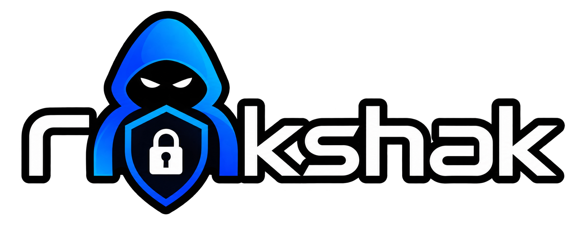
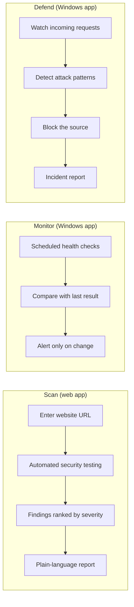

[README.md](https://github.com/user-attachments/files/34742356/README.md)

  

<h3 align="center">Website security that small businesses can actually use.</h3>

  Scan your site. Get alerted when something changes. Stop attacks as they happen. 
  In plain language, with your monitoring data staying on your own machine.

  
  
  
  

  <a href="#the-problem">The problem</a> ·
  <a href="#what-rakshak-does">What it does</a> ·
  <a href="#who-it-helps">Who it helps</a> ·
  <a href="#how-it-works">How it works</a> ·
  <a href="#tech-stack">Tech stack</a> ·
  <a href="#privacy-by-design">Privacy</a> ·
  <a href="#plans">Plans</a> ·
  <a href="#team">Team</a>

---

## The problem

Millions of small businesses in India now live on their websites: the bakery with an online order form, the clinic with a booking page, the freelancer with a portfolio and a payment link. Almost none of them have a security team, and most have no idea whether their site is safe.

The options on offer don't fit them. Enterprise security platforms are priced and designed for companies with a SOC. Free scanners print a wall of technical jargon and leave the owner guessing what to do next. And when an attack does happen, owners usually find out days later from a customer, with no record of what happened and nothing to show the police.

Rakshak (रक्षक, "protector") is built for the owner who is not a security expert and shouldn't have to be.

## What Rakshak does

### 1. Scan: find out where you stand

Paste your website's address and Rakshak checks it for known weaknesses. The report sorts every finding by severity, from critical to informational, and explains each one in plain language with a clear next step. Results show up while you're still on the page.

### 2. Monitor: know the moment something changes

The Windows app keeps watching your site in the background. It checks that the site is up, that your SSL certificate is valid and not about to expire, and that the security protections your visitors' browsers rely on are in place. When something changes for the worse you get a desktop notification, and you get it once, not every few minutes. Alerts can also go to Slack, email, or straight into a GitHub issue for your developer.

### 3. Defend: stop the attack, keep the evidence *(early access)*

Defense mode adds an active layer in front of your site. It recognises common attack patterns such as SQL injection, cross-site scripting, and request floods, blocks the offending source, and records everything. Afterwards it produces an incident report: what kind of attack it was, how many malicious requests were made, when it was blocked, what was exposed, and what is known about where it came from. It is written so you can attach it to a cybercrime complaint.

## How it helps

| Without Rakshak | With Rakshak |
|---|---|
| You learn about a problem when a customer reports it | You get a notification as soon as something changes |
| Scan reports full of jargon | Every finding explained in plain language, with a fix |
| Expired certificates quietly scare visitors away | Expiry warnings before it happens |
| After an attack, nothing to show the police | A single incident report you can attach to a complaint |
| Security tools priced for enterprises | Plans built for small sites, starting free |
| Your security data uploaded to a third-party cloud | Monitoring and defense data stays on your machine |

## Who it helps

**Small business owners.** You run an online store, a booking page, or a lead form, and you want to know it's safe without learning security.

**Freelancers and small agencies.** You maintain sites for clients and need a quick, readable report to show them, plus an alert if something breaks overnight.

**Students and early-stage startups.** You're shipping fast and want a sanity check before real users arrive.

## How it works

A simplified view of what happens behind each feature.

## Tech stack

| Layer | Technology |
|---|---|
| Web app | React, Vite, Tailwind CSS |
| Backend | Python, FastAPI, SQLAlchemy, Alembic |
| Database | PostgreSQL (Supabase) |
| Authentication | JWT |
| Security scanning | OWASP ZAP |
| Payments | Razorpay |
| Integrations | Corsair (Slack, Gmail, GitHub) |
| Windows app | Python, PySide6 |
| Local storage | SQLite |
| Notifications | plyer |

## Privacy by design

Your web scan history lives in your account so your dashboard can show it. The Windows app works differently on purpose: monitoring results, request logs, blocked-IP lists, and incident reports are stored in a local database on your own computer. They are not uploaded anywhere. The only outside lookup the defense feature makes is for the origin of a public attacker address.

Accounts use identity verification so that a security tool is not anonymous by default.

## Plans

| | Free | Pro Monitoring | Defense *(early access)* |
|---|---|---|---|
| Website vulnerability scan | Yes | Yes | Yes |
| Plain-language reports and scan history | Yes | Yes | Yes |
| Windows app with continuous monitoring | | Yes | Yes |
| Slack, email, and GitHub alerts | | Yes | Yes |
| Active attack blocking | | | Yes |
| Incident reports for cybercrime complaints | | | Yes |

## What to know

Honest limits, so nothing surprises you:

- **The scan is built to be quick, not exhaustive.** It is not a full penetration test and will not find everything a deep manual audit would.
- **Monitoring is periodic.** It checks your site every few minutes; it does not inspect live traffic.
- **Tracing means IP-level attribution.** We can show who owns a public address and where it is registered. We cannot unmask someone using a VPN or Tor, and an address on a private network has no location.
- **Identity verification currently runs in a sandbox.** Production Aadhaar verification requires a UIDAI-licensed provider, which is on the roadmap.
- **Payments are in test mode** while we prepare for launch.

## Roadmap

- Domain ownership verification before scanning
- Production identity verification through a licensed provider
- Windows installer
- Scheduled deep scans
- Live payments

## Use it responsibly

Only scan websites you own or have written permission to test. Scanning someone else's site can be illegal. To try Rakshak without touching a real site, use a deliberately vulnerable practice application such as OWASP Juice Shop.

## Team

- Swapnil
- Naman Priya Sharma
- Ishika Goyal
- Ashwin Singh Pramar
